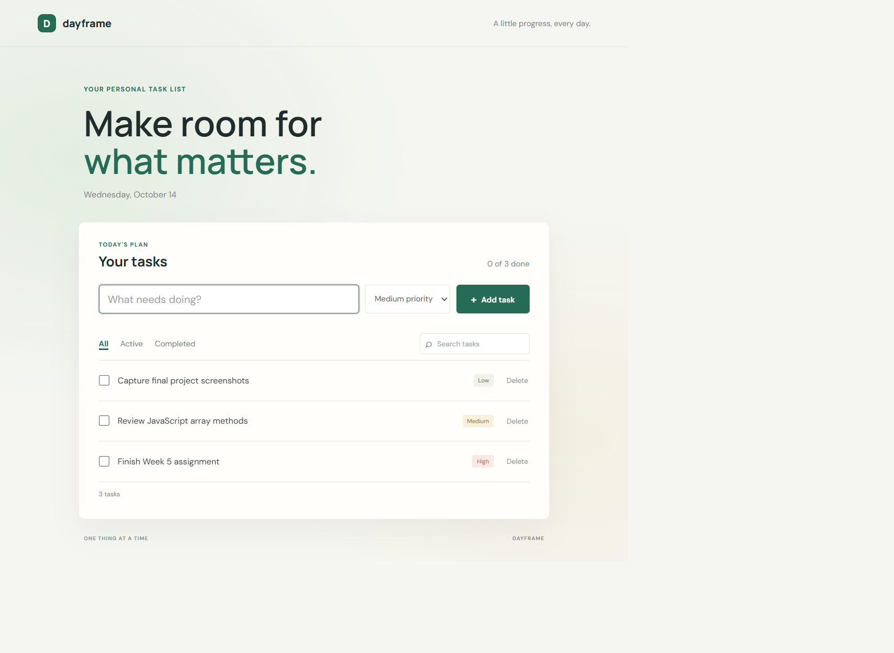
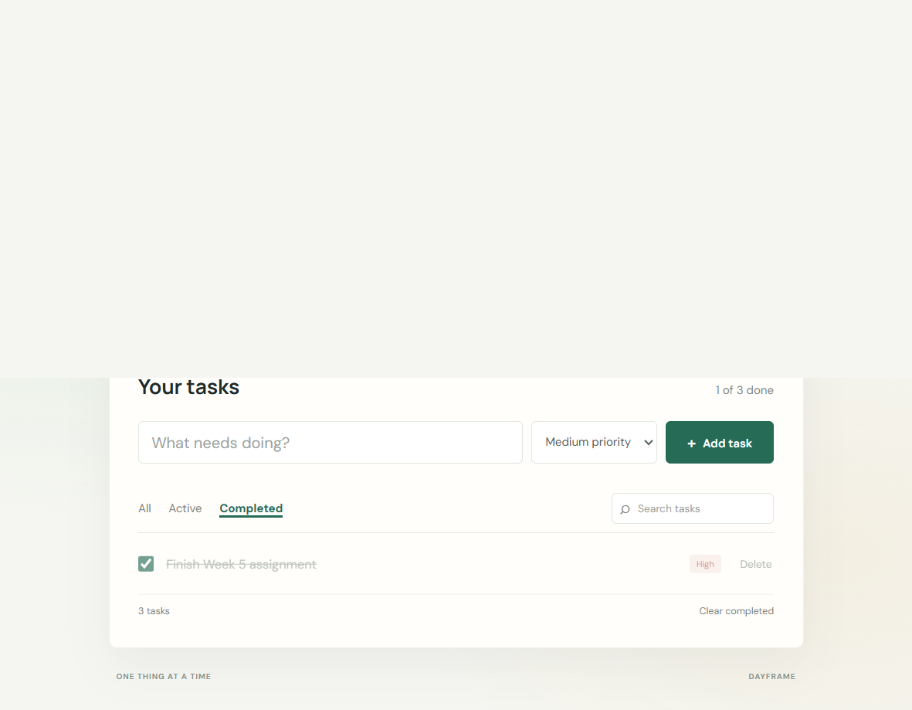

# Dayframe: a beginner-friendly to-do list

## Project plan

- **Project title:** Dayframe To-do List
- **Objective:** Build a practical task list that helps a person organize everyday work and see their progress.
- **Target users:** Students and anyone who wants a simple personal task planner.
- **Main features:** Add tasks with a priority, mark them complete, delete individual tasks, search by task name, filter by status, clear completed tasks, and save tasks in the browser.
- **Technologies:** HTML, CSS, and plain JavaScript. No installation or build tools are required.
- **Project description:** Dayframe is a responsive single-page application. A user can enter a task, choose its priority, and manage it from a live list. The app stores the list in the browser so it remains after a refresh.

## Run the project

Open `index.html` in a browser. Add a task, choose its priority, and press **Add task**. Use the checkbox to complete a task. The **All**, **Active**, and **Completed** filters, along with the search box, help find tasks. Select **Delete** to remove one task or **Clear completed** to remove all finished tasks. Tasks are stored in local storage in that browser.

## JavaScript concepts used

The project uses variables, arrays of task objects, functions, conditionals, event listeners, loops, and array methods (`filter`, `map`, and `forEach`). It selects and creates DOM elements, updates page content, handles form and input events, and saves data with `localStorage`.

## Screenshots

*Main task list with sample tasks and priority labels.*

*Completed filter showing a finished task.*

## Project reflection (300–400 words)

Dayframe is a small to-do list made to help students and other busy people keep track of everyday work. The goal was to turn the JavaScript topics from Weeks 3 and 4 into a complete page that is simple to use. I built the page with HTML, styled it with CSS, and added its interactive behavior with plain JavaScript. It runs directly in a browser and does not need a framework or installation.

The app lets a user add a task and select a low, medium, or high priority. A checkbox marks a task as complete, and a delete button removes an individual task. The All, Active, and Completed filters show different parts of the list. Search finds tasks by their text, a progress counter shows how many are complete, and a clear button removes all completed tasks. The browser's local storage remembers the list after the page is refreshed.

While building the project, I used variables to store page elements and application data. I represented each task as an object and kept tasks in an array. Functions separate work such as adding tasks, saving data, updating the count, and drawing the list. Conditional statements decide which tasks match the selected filter. Array methods including `filter`, `map`, and `forEach` search, update, and display the tasks. Event listeners respond to form submissions, text input, filter buttons, checkboxes, and delete actions. The DOM API creates list items and updates what the user sees.

One challenge was keeping the task list, progress count, and saved browser data in sync after every change. I addressed this by saving the array and calling the same render function after an add, completion, deletion, or clear action. Another challenge was making search and status filters work together. I combined both checks when choosing visible tasks, so a search does not cancel the selected filter.

This project helped me understand how JavaScript objects, arrays, functions, events, and DOM updates work together in a real application. I also learned that small usability details, such as trimming empty input and showing a useful empty state, make a project easier to use. In the future, I would add due dates, task editing, and an option to export the list. I would also test the page in more browsers and gather feedback from classmates.

 